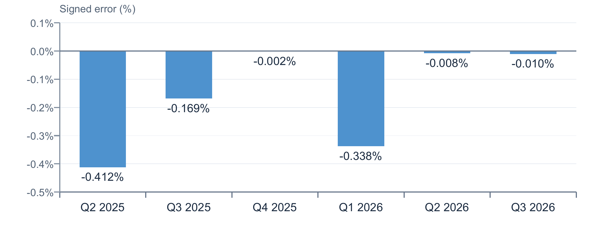

# Estimating Circle (CRCL) Reserve Income with On Chain Data

## The hypothesis

I begin with a testable hypothesis: **public on-chain data can be used to estimate Circle's quarterly reserve income before the company reports it**. The majority of Circle’s revenue comes from the short-term interest earned from USDC. Hence, if public USDC circulation is a reliable proxy for the reserve income, and public interest rates provide a useful guide to the return on that balance, the resulting estimates should come close to the income Circle later discloses.

I believe Circle makes an interesting meeting point between on-chain research and traditional financial analysis:

The blockchain is able to help us observe how much USDC is outstanding. 

Public rate and fund disclosures help us estimate how much USDC might earn. 

Financial statements then give us an independent outcome against which to judge the model. 

Each source answers a different part of the same income question.

To test the hypothesis, I first compare several ways of turning balances and yields into an income estimate, starting with simple baselines and adding economic detail. After that, I compare every method with the same six reported quarterly outcomes. The aim is to learn which information improves the estimate.

This is the first part of the report, which follows reserve income from source data to a measured historical result and then to a dated forward scenario. The conclusion sets up Part 2: whether other Circle-related on-chain data can help explain the remaining revenue and costs well enough to estimate earnings per share. The historical exercise recreates pre-announcement information cutoffs using later-downloaded histories; it is not a record of forecasts actually made before those past releases.

## Build the evidence before choosing a model

### Why Circle makes the hypothesis testable

USDC is a dollar-denominated stablecoin. Circle invests the reserves supporting its circulation, so reserve income depends primarily on the size of the reserve balance and the return earned on the reserve assets. The token's public circulation gives an outside analyst a frequent proxy for the earning balance. The interest itself, bank holdings, fund allocations and recognition adjustments are not all recorded in token transfers.

Blockchain data provide the balance exposure. Public rate and fund disclosures provide yield proxies. Financial statements establish the accounting target and the lagged calibration. Our model combines these sources rather than claiming that an equity income statement exists entirely on chain. 

For illustration, an additional $1bn of average reserves earning 4% annually for a 90-day quarter contributes about $9.863m before other adjustments. A quarter-end balance does not establish that the same amount was outstanding for all 90 days. That is why daily balance exposure matters.

This gives us two quantities to estimate: the balance that was outstanding throughout the quarter and the yield earned on that balance. Before estimating, I need to define the financial figure that will count as the actual result. Otherwise, a precise calculation could still be answering the wrong accounting question.

### Define the income figure I am trying to predict

I therefore begin with the outcome ledger, keeping it separate from the predictors. **The target is Circle's reported reserve income for each quarter, not its total revenue**, its quarter-end USDC balance or its earnings per share. 

I first create a seven-quarter accounting ledger from original SEC filings and earnings materials. Extract the reserve-income line separately from total revenue and reserve income.

| Period | Days | Reserve income USD m | Average USDC USD bn |
| --- | --- | --- | --- |
| Q1 2025 | 90 | 557.911 | 54.136 |
| Q2 2025 | 91 | 634.274 | 61.039 |
| Q3 2025 | 92 | 711.241 | 67.842 |
| Q4 2025 | 92 | 733.396 | 76.200 |
| Q1 2026 | 90 | 652.508 | 75.200 |
| Q2 2026 | 91 | 667.733 | 76.524 |
| Q3 2026 | 92 | 657.624 | 73.264 |

Q1 2025 supplies the first lagged calibration, leaving Q2 2025 through Q3 2026 as six target quarters. With the target defined, the next question is whether I can observe the earning balance independently of that quarter's financial result.

### Check the public balance before using it

The first empirical test is a data-quality test, not yet an income prediction. If public USDC balances differ materially from Circle's own circulation figures, any later yield calculation could give a misleading answer. I therefore inspect the source and compare both average and closing balances before accepting it as the working reserve proxy.

The working daily source is the free [DefiLlama USDC history endpoint](https://stablecoins.llama.fi/stablecoin/2). Since a secondary market depeg in USDC can change its market value without changing the reserve liability dollar for dollar, I use token circulation, not a market capitalization that fluctuates with a traded price. I do not sum all token balances across chains as third-party bridged representations can be backed by already counted native USDC locked elsewhere.

#### Checking DefiLlama’s USDC supply against Circle disclosures

I compare both quarter-average circulation and quarter-end stock against Circle's disclosed figures. 

| Period | DefiLlama Average USD bn | Reported Average USD bn | Average Difference | End Stock Difference |
| --- | --- | --- | --- | --- |
| Q1 2025 | 54.051 | 54.136 | -0.156% | +0.277% |
| Q2 2025 | 60.912 | 61.039 | -0.208% | -0.161% |
| Q3 2025 | 67.504 | 67.842 | -0.499% | -0.132% |
| Q4 2025 | 75.896 | 76.200 | -0.398% | +0.073% |
| Q1 2026 | 75.287 | 75.200 | +0.116% | +0.113% |
| Q2 2026 | 76.733 | 76.524 | +0.273% | +0.288% |
| Q3 2026 | 73.521 | 73.264 | +0.351% | +0.365% |

The end-stock comparison consistently uses the provider's following-date bucket against the attested quarter-end circulation. All seven end-stock comparisons fall inside 0.5% range, approximately −0.161% to +0.365%. Average differences range from −0.499% to +0.351%, also inside a tight range. This is sufficient to use the series as a balance proxy under the accepted tolerance, but not to claim an exact reconciliation. No fixed correction is applied to force the data to match.

#### Direct contract validation

The broad daily income model uses DefiLlama because rebuilding complete historical state for every supported chain would add substantial archive infrastructure and reconciliation work. A third-party aggregator can be a practical production source while authenticated direct-chain samples test important parts of its perimeter.

Having accepted a practical balance source, I turned to that second half of the hypothesis.

### Choosing yields that a public analyst can observe

I consider a broad money-market benchmark, a simple Treasury-market quote and a disclosure from the reserve fund itself. These alternatives let us test whether the choice of observable rate matters and whether a benchmark needs a company-specific adjustment.

#### SOFR

The [Federal Reserve Bank of New York](https://www.newyorkfed.org/markets/reference-rates/sofr) publishes SOFR, a measure of overnight borrowing costs collateralized by Treasury securities. An effective day's SOFR normally becomes public on the following business day. SOFR accrual is calculated on an actual over 360 basis. Daily uncalibrated income is daily supply multiplied by annual SOFR divided by 360. To subtract it from an implied yield annualized over 365, first multiply SOFR by 365/360. Mixing a 360-day raw benchmark with a 365-day implied yield without this conversion creates an avoidable systematic difference.

#### A Treasury quote as an alternative benchmark

Alongside SOFR, I collect the three-month Treasury constant-maturity series (DGS3MO in Refinitiv Workspace) as another simple public benchmark. Its role is to test an alternative rate proxy. A quoted Treasury yield is not the same as the income generated by Circle's actual portfolio, so this method will be judged against the reported results rather than assumed correct because reserves contain Treasury exposure.

#### The Circle Reserve Fund net seven day yield

Other than that, I also used the **Circle Reserve Fund's net seven-day yield**, which I refer to as the fund model later on. The fund is managed within BlackRock's money market fund reporting framework. A seven-day yield is an annualized measure based on a recent seven-day income window. 

For a concrete source check, the [June 2026 original report](https://www.sec.gov/Archives/edgar/data/844779/000119312526298262/primary_doc.xml), filed 8 July, contains a 30 June net-yield observation of **0.036**, or **3.60% annually**. Its same-date gross yield is 0.0369, or 3.69%. The [September original report](https://www.sec.gov/Archives/edgar/data/844779/000119312526416631/primary_doc.xml), filed 7 October, contains a 30 September net yield of **0.0384**, or **3.84%**, and gross yield of 3.93%.

#### Mapping business observations to daily balances

I then multiply each day's USDC balance by this annualized yield divided by 365. Sum those daily contributions over the full quarter. 

For the normal late cutoffs in this sample, the target quarter's last-month original fund report was already public. At the seven-days-after-quarter-end Q3 2026 cutoff of 7 October, the September report is eligible because it was filed that day. 

I now have candidate daily balances and yield proxies. One final condition must be imposed before building the models: **the information must have been public at the simulated prediction date**. A historically accurate yield that was released too late cannot be used to support a pre-earnings estimate.

### Date Matching

I apply the same information rule to every candidate: use eligible lagged financial inputs, dated balances and the yield observations available by the selected cutoff. This matters particularly for monthly fund filings, where the economic observation date precedes the publication date. The two cutoffs below test an early post-quarter estimate and a later pre-announcement estimate.

| Period | Early cutoff | Late cutoff | Earnings date |
| --- | --- | --- | --- |
| Q2 2025 | 2025-07-07 | 2025-08-11 | 2025-08-12 |
| Q3 2025 | 2025-10-07 | 2025-11-11 | 2025-11-12 |
| Q4 2025 | 2026-01-07 | 2026-02-24 | 2026-02-25 |
| Q1 2026 | 2026-04-07 | 2026-05-10 | 2026-05-11 |
| Q2 2026 | 2026-07-07 | 2026-08-04 | 2026-08-05 |
| Q3 2026 | 2026-10-07 | 2026-11-03 | 2026-11-04 |

The early estimate is taken seven calendar days after quarter-end. The late estimate uses the calendar day before the verified earnings release. At each cutoff, the immediately previous quarter's relevant financial inputs must already be public. 

With the target, the balance source, the yield candidates and the information rules established, I will then further compare models on a common basis.

## Testing different reserve income models

### Prior income with a day adjustment

Multiply the previous quarter's reserve income by target-quarter days divided by previous-quarter days. This naive baseline knows the prior financial result and calendar, but does not update for the target quarter's supply or interest-rate changes. It is useful precisely because it is easy to implement and makes the incremental value of a richer model visible.

### Current supply with the prior earned yield

The second method asks whether updating the balance is enough. If the reserve yield changes materially, a correct supply series may still leave a meaningful income error, which motivates updating the rate as well.

Multiply the target quarter's sum of daily USDC balances by the previous implied annual company yield and divide by 365. This updates balance exposure but assumes that earned yield does not change. It is a useful test of whether supply alone is sufficient when rates move.

### Current supply with uncalibrated SOFR

This tests whether current balances and a market rate alone can explain the reported income. Any persistent difference between the benchmark and Circle's realized yield will remain uncorrected.

Sum daily balances times daily SOFR divided by 360. This updates both balances and a benchmark rate but assumes that all reserves earn the benchmark without a persistent company-to-benchmark difference. Its systematic overestimation in this sample shows why an observable rate is not automatically Circle's realized return.

### Current supply with the three month Treasury yield

The Treasury version helps distinguish a benchmark-choice problem from a broader calibration problem. Both raw market-rate methods must succeed on the same financial target rather than be accepted on economic intuition alone.

Use the daily three-month Treasury constant-maturity series, carry the last business observation over non-reporting dates, and sum daily balance times annual quoted yield divided by 365. It is included as a plausible simple alternative rather than an exact portfolio-income method.

### SOFR with the previous yield gap

The fifth method addresses that calibration problem using only the previous quarter's financial outcome. Its additional assumption is that the last observed yield gap remains useful for the next quarter. Calculate the previous implied company yield. Subtract the previous supply-weighted SOFR after its 365/360 conversion. Carry that fixed annual percentage-point gap into the target quarter. The estimate is uncalibrated target-quarter SOFR income plus target-quarter balance exposure multiplied by the lagged gap and divided by 365.

The gap is an empirical bridge. Reserve allocation, fund expenses, deposit rates, small non-USDC income and balance-definition differences can all contribute. I cannot identify its exact economic components from this regression-free calibration alone, and a stable gap is an assumption to test.

### Fund yield with the previous yield gap

The sixth method keeps the same calibration structure but changes the benchmark to the fund disclosure. Comparing it with the SOFR version tests whether a benchmark closer to the reserve vehicle improves the estimate once both use the same lagged-gap logic.

I used the same architecture with the fund's net seven-day yield. Subtract the previous supply-weighted fund yield from the previous implied company yield, then add that gap to the target quarter's daily fund yields. The fund benchmark already incorporates its expenses, but it does not equal the return on all cash and other reserve assets. The lagged correction therefore remains necessary.

The formula can be explained without fitting a statistical model: first establish how the public benchmark related to Circle's realized yield last quarter; then update for this quarter's publicly observable benchmark and reserve balance. No target-quarter reserve-income outcome enters either calibrated prediction.

At this point the model definitions are fixed for the comparison.

## Demonstrating the calculation with Q2 2026

The target quarter has 91 calendar days. The previous quarter is Q1 2026. Its reported reserve income is **$652.508m**, average USDC is **$75,200.000m**, and its length is 90 days. These are lagged inputs. The information cutoff is **2026-08-04**, before the **2026-08-05** earnings release.

#### Step 1: Calculate the previous earned yield

Divide the previous quarter's reserve income by its reported average USDC, then annualize over its actual day count. The calculation is 652.508000 / 75,200.000000 × 365 / 90 = **3.518992612%**. 

#### Step 2: Assemble the target balance exposure

Read every calendar-date USDC observation for the target quarter and sum the balances. The total is **6,982,711.353501 million USDC days**. Dividing by 91 gives the provider's average balance of **$76,733.091797m**. 

#### Step 3: Read and align the fund yields

Use only original monthly Form N-MFP3 reports filed by 2026-08-04. For each calendar day, use the most recent business-date net seven-day yield whose observation date is not later than that day. Carry the prior observation through non-reporting dates; do not interpolate using a future yield. The longest carry in this target quarter is **3 calendar days**.

The previous quarter's USDC-weighted fund yield is **3.600284141%**. The target quarter's weighted fund yield is **3.570727382%**. Each is the sum of daily supply times the applicable annual yield, divided by that quarter's sum of daily supply.

#### Step 4: Calibrate the gap and estimate fund income

Subtract the previous weighted fund yield from the previous implied Circle yield: 3.518992612% − 3.600284141% = **-0.081291529 percentage points**, or **-8.129153 basis points**. A negative number means the prior implied company yield was below this fund benchmark. It is not evidence of a contractual charge at that rate.

Before calibration, summing daily supply times daily fund yield divided by 365 gives **$683.105715995m**. The fixed lagged gap contributes 6,982,711.353501 × (-0.000812915287) / 365 = **$-15.551651512m**. Add the two to obtain **$667.554064482m**. The combined adjusted annual yield is **3.489435854%**.

#### Step 5: Run the independent SOFR benchmark

SOFR is quoted on an actual over 360 convention. Sum daily supply times the applicable SOFR divided by 360. That produces **$702.007145449m** before calibration. Convert the lagged benchmark to the model's annual 365 basis before comparing it with Circle's implied yield: the lagged weighted SOFR equivalent is **3.710788835%**. Subtracting it from the implied Circle yield gives **-0.191796223 percentage points**.

The gap correction is 6,982,711.353501 × (-0.001917962228) / 365 = **$-36.691990748m**. The SOFR estimate is therefore **$665.315154701m**. This construction is equivalent to summing daily supply times the sum of SOFR multiplied by 365/360 and the lagged gap, all divided by 365.

#### Step 6: Compare with the subsequently reported actual

Circle's original financial filing reports **$667.733000m** of reserve income for this quarter. The fund estimate differs by **$-0.178936m**, or **-0.026797%**. The SOFR estimate differs by **$-2.417845m**, or **-0.362098%**. Error equals estimated income divided by actual income minus one. Preserve the prediction before attaching the target; do not use this error to recalibrate the same quarter.

The Q2 result shows that the calculation can be traced from public inputs to a small observed error. It does not establish that the method works consistently. To test that broader claim, I now repeat the comparison across every target quarter, including the quarters in which the models perform less well. A second full numerical walkthrough for Q3 2026 is retained in Appendix A.

## What the historical tests tell us

| Method | MAPE | MAE USD m | Worst absolute error |
| --- | --- | --- | --- |
| Prior income with day adjustment | 6.287% | 42.114 | 11.062% |
| Supply with prior earned yield | 3.281% | 22.614 | 8.636% |
| Supply with uncalibrated SOFR | 5.140% | 34.785 | 5.573% |
| Supply with three month Treasury yield | 4.970% | 32.819 | 11.072% |
| SOFR with prior yield gap | 0.337% | 2.268 | 0.896% |
| Fund yield with prior yield gap | 0.237% | 1.579 | 0.587% |

Mean absolute percentage error, or MAPE, is the average of the absolute value of estimated income divided by actual income minus one. MAE is the average absolute dollar difference in USD millions. The worst-quarter column reports the largest absolute percentage error. 

Both original calibrated methods beat the carry-forward baseline in six of six quarters. Updating supply without updating yield improves the mean error from 6.287% to 3.281%, but still leaves meaningful rate-cycle exposure. Uncalibrated SOFR averages 5.140% error and overestimates all six actuals. Adding the lagged gap brings SOFR to 0.337%; the fund version reaches 0.237%. The fund advantage is about $0.688m in average absolute error, a small difference relative to the uncertainty of six observations and the supply-data tolerances.

Updating the balance helps, but leaving the earned yield unchanged is insufficient. Updating to a raw market rate also leaves a substantial error. The strongest original results arise when current balances and rates are joined to the previous quarter's company-to-benchmark gap. The evidence therefore supports the combined economic mechanism, not the idea that multiplying USDC by any Treasury-like rate will automatically reproduce Circle's income.

The table below retains all six target periods for the original SOFR and fund gap models.

| Period | Actual USD m | SOFR gap USD m | Error | Fund gap USD m | Error |
| --- | --- | --- | --- | --- | --- |
| Q2 2025 | 634.274 | 633.095 | -0.186% | 631.591 | -0.423% |
| Q3 2025 | 711.241 | 709.903 | -0.188% | 710.060 | -0.166% |
| Q4 2025 | 733.396 | 730.779 | -0.357% | 731.909 | -0.203% |
| Q1 2026 | 652.508 | 646.662 | -0.896% | 648.677 | -0.587% |
| Q2 2026 | 667.733 | 665.315 | -0.362% | 667.554 | -0.027% |
| Q3 2026 | 657.624 | 657.831 | +0.032% | 657.739 | +0.017% |

These results support the hypothesis within this historical sample: useful reserve-income visibility can be obtained from public data without using the target quarter's reported income to calibrate its own prediction.

### Does waiting until just before earnings improve the result

The original fund early-cutoff MAPE is approximately **0.242%**, compared with **0.237%** late. SOFR is approximately **0.337%** in both phases. These results do not show that waiting until the day before earnings necessarily adds substantial information once a quarter has ended and the relevant sources are available. They also do not establish a tradable advantage over analyst consensus, which was not evaluated.

The small early-versus-late difference suggests that, in these tested quarters, most of the required reserve-income information was already available soon after quarter-end. That is useful for the research objective, but it remains subject to the date-level cutoff and historical-vintage limitations established before the models were run.

### Could a different yield adjustment improve the model

The original rule assumes an additive yield gap persists. If the prior company yield is 3.50% and the prior fund yield is 3.57%, the gap is −0.07 percentage points, or −7 basis points. Subtracting 0.07 percentage points from a new 3.62% benchmark gives a 3.55% company-yield estimate. This is different from subtracting 7% of the yield.

A proportional alternative instead assumes the prior ratio of company yield to benchmark yield persists. In that illustration, multiply the new benchmark by 3.50/3.57. Additive and proportional rules can be close when the benchmark moves little, but diverge across interest-rate regimes. Neither is inherently the true reserve-income mechanism.

In a subsequent exploratory comparison, both ratios are tested on the same six quarters. Fund proportional MAPE is **0.156%**, compared with **0.237%** for its additive version. SOFR proportional MAPE is **0.193%**, compared with **0.337%**. Fund proportional improves five of six quarters and SOFR proportional four of six. Fund proportional MAE is approximately **$1.025m**, with worst-quarter absolute error **0.412%**.

#### Signed prediction error for the fund yield with prior yield ratio method

Late-cutoff results for the same six quarters shown in the dashboard chart. Signed error = estimate / reported reserve income - 1. Negative values mean underestimation; positive values mean overestimation. Percentages are shown to three decimal places.

This refinement leaves the central finding intact: the balance series becomes more useful when the benchmark is connected to Circle's previously observed earned yield.

## Explore the reserve income dashboard

Visit the Circle (CRCL) Reserve Income Forecast dashboard to compare historical methods, inspect quarterly prediction errors and explore the current reserve-income estimate. The dashboard brings together the data and calculations discussed in this report: [https://ziyik0612.me/circle/](https://ziyik0612.me/circle/)

## Conclusion and the question for Part 2

I started with the hypothesis that public data could be used to estimate Circle's reserve income before its disclosure. The research supports that hypothesis in the six-quarter historical sample, subject to the stated information and vintage limits. The balance source passed the accepted checks against Circle's circulation disclosures. The model comparison then shows that balance visibility becomes substantially more useful when observable yields are adjusted using Circle's previously reported economics.

The main result is therefore a method, not just a small error statistic: validate the balance, align the public yield and its publication date, calculate a lagged company-to-benchmark relationship, save the estimate, and only then compare it with the reported outcome. 

The original SOFR and fund models achieved mean absolute percentage errors of 0.337% and 0.237%, respectively, against 6.287% for carrying prior income forward. The next step will be deriving the actual net profit from here. Reserve income is a gross income line. To estimate Circle's earnings per share, Part 2 must connect it to other revenue, distribution and transaction costs, operating expenses, non-operating items, taxes and the applicable weighted-average diluted share count. A close reserve-income estimate can still coexist with a large EPS error if those remaining items are wrong.

## Appendix A Worked example for Q3 2026

This second walkthrough uses the same original additive methods as the Q2 example in the main narrative. 

The target quarter has 92 calendar days. The previous quarter is Q2 2026. Its reported reserve income is **$667.733m**, average USDC is **$76,524.000m**, and its length is 91 days. These are lagged inputs; the target quarter's actual income is used only at the final scoring step. The information cutoff is **2026-11-03**, before the **2026-11-04** earnings release.

### Step 1: Calculate the previous earned yield

Divide the previous quarter's reserve income by its reported average USDC, then annualize over its actual day count. The calculation is 667.733000 / 76,524.000000 × 365 / 91 = **3.499908166%**. This is an implied annual yield proxy, not Circle's rounded return KPI and not the fund's own yield.

### Step 2: Assemble the target balance exposure

Read every calendar-date USDC observation for the target quarter and sum the balances. The total is **6,763,917.231610 million USDC days**. Dividing by 92 gives the provider's average balance of **$73,520.839474m**.

### Step 3: Read and align the fund yields

Use only original monthly Form N-MFP3 reports filed by 2026-11-03. For each calendar day, use the most recent business-date net seven-day yield whose observation date is not later than that day. Carry the prior observation through non-reporting dates; do not interpolate using a future yield. The longest carry in this target quarter is **3 calendar days**.

The previous quarter's USDC-weighted fund yield is **3.570727382%**. The target quarter's weighted fund yield is **3.620163781%**. Each is the sum of daily supply times the applicable annual yield, divided by that quarter's sum of daily supply. 

### Step 4: Calibrate the gap and estimate fund income

Subtract the previous weighted fund yield from the previous implied Circle yield: 3.499908166% − 3.570727382% = **-0.070819216 percentage points**, or **-7.081922 basis points**. A negative number means the prior implied company yield was below this fund benchmark. It is not evidence of a contractual charge at that rate.

Before calibration, summing daily supply times daily fund yield divided by 365 gives **$670.862689890m**. The fixed lagged gap contributes 6,763,917.231610 × (-0.000708192160) / 365 = **$-13.123707280m**. Add the two to obtain **$657.738982610m**. The combined adjusted annual yield is **3.549344565%**.

### Step 5: Run the independent SOFR benchmark

SOFR is quoted on an actual over 360 convention. Sum daily supply times the applicable SOFR divided by 360. That produces **$689.264364852m** before calibration. Convert the lagged benchmark to the model's annual 365 basis before comparing it with Circle's implied yield: the lagged weighted SOFR equivalent is **3.669528857%**. Subtracting it from the implied Circle yield gives **-0.169620690 percentage points**.

The gap correction is 6,763,917.231610 × (-0.001696206902) / 365 = **$-31.432885179m**. The SOFR estimate is therefore **$657.831479673m**. This construction is equivalent to summing daily supply times the sum of SOFR multiplied by 365/360 and the lagged gap, all divided by 365.

### Step 6: Compare with the subsequently reported actual

Circle's original financial filing reports **$657.624000m** of reserve income for this quarter. The fund estimate differs by **$0.114983m**, or **+0.017485%**. The SOFR estimate differs by **$0.207480m**, or **+0.031550%**. Error equals estimated income divided by actual income minus one. 

## Appendix B Financial actuals and announcement sources

| Period | Announcement | Original release | Supporting filing actual USD m |
| --- | --- | --- | --- |
| Q2 2025 | 2025-08-12 | [Release exhibit](https://www.sec.gov/Archives/edgar/data/1876042/000162828025039749/q22025epr.htm) | 634.274 |
| Q3 2025 | 2025-11-12 | [Release exhibit](https://www.sec.gov/Archives/edgar/data/1876042/000187604225000045/nolivelinksversion_q3202.htm) | 711.241 |
| Q4 2025 | 2026-02-25 | [Release exhibit](https://www.sec.gov/Archives/edgar/data/1876042/000187604226000032/final_circlereportsfourt.htm) | 733.396 |
| Q1 2026 | 2026-05-11 | [Release exhibit](https://www.sec.gov/Archives/edgar/data/1876042/000187604226000148/final_05x11q1epr30.htm) | 652.508 |
| Q2 2026 | 2026-08-05 | [Release exhibit](https://www.sec.gov/Archives/edgar/data/1876042/000187604226000246/augustepr-circle_q22026f.htm) | 667.733 |
| Q3 2026 | 2026-11-04 | [Release exhibit](https://www.sec.gov/Archives/edgar/data/1876042/000187604226000309/finalq3epr-110326.htm) | 657.624 |

The reserve-income ledger below supplies the exact scoring values and their archived locators. Announcement dates and release exhibits provide the corresponding reporting-event record. The filing extraction and the release timing serve different purposes in the test.

| Period | Ledger reference | Locator or derivation | Source |
| --- | --- | --- | --- |
| Q1 2025 | O013 | Row 186 col 1 | [Original filing](https://www.sec.gov/Archives/edgar/data/1876042/000119312525135795/d737521d424b4.htm) |
| Q2 2025 | O023 | Row 120 col 1 | [Original filing](https://www.sec.gov/Archives/edgar/data/1876042/000162828025039781/crcl-20250630.htm) |
| Q3 2025 | O033 | Row 120 col 1 | [Original filing](https://www.sec.gov/Archives/edgar/data/1876042/000187604225000047/crcl-20250930.htm) |
| Q4 2025 | FY less 9M | 2,636.822 minus 1,903.426 | [FY filing](https://www.sec.gov/Archives/edgar/data/1876042/000187604226000062/crcl-20251231.htm) |
| Q1 2026 | O047 | Row 127 col 1 | [Original filing](https://www.sec.gov/Archives/edgar/data/1876042/000187604226000150/crcl-20260331.htm) |
| Q2 2026 | O057 | Row 128 col 1 | [Original filing](https://www.sec.gov/Archives/edgar/data/1876042/000187604226000248/crcl-20260630.htm) |
| Q3 2026 | O067 | Row 126 col 1 | [Original filing](https://www.sec.gov/Archives/edgar/data/1876042/000187604226000311/crcl-20260930.htm) |

## Appendix C Original fund report archive

Each linked report is an original monthly filing used in the fund-yield extraction. Use its filing date to establish availability, not the month-end report date.

| Month | Filed | Business observations | SEC source |
| --- | --- | --- | --- |
| 2024-12 | 2025-01-07 | 21 | [Original report](https://www.sec.gov/Archives/edgar/data/844779/000114554925000837/primary_doc.xml) |
| 2025-01 | 2025-02-06 | 21 | [Original report](https://www.sec.gov/Archives/edgar/data/844779/000114554925006067/primary_doc.xml) |
| 2025-02 | 2025-03-06 | 19 | [Original report](https://www.sec.gov/Archives/edgar/data/844779/000114554925016532/primary_doc.xml) |
| 2025-03 | 2025-04-07 | 21 | [Original report](https://www.sec.gov/Archives/edgar/data/844779/000114554925024211/primary_doc.xml) |
| 2025-04 | 2025-05-07 | 21 | [Original report](https://www.sec.gov/Archives/edgar/data/844779/000114554925029363/primary_doc.xml) |
| 2025-05 | 2025-06-06 | 21 | [Original report](https://www.sec.gov/Archives/edgar/data/844779/000114554925038812/primary_doc.xml) |
| 2025-06 | 2025-07-07 | 20 | [Original report](https://www.sec.gov/Archives/edgar/data/844779/000114554925045932/primary_doc.xml) |
| 2025-07 | 2025-08-06 | 22 | [Original report](https://www.sec.gov/Archives/edgar/data/844779/000114554925050582/primary_doc.xml) |
| 2025-08 | 2025-09-08 | 21 | [Original report](https://www.sec.gov/Archives/edgar/data/844779/000114554925057954/primary_doc.xml) |
| 2025-09 | 2025-10-07 | 21 | [Original report](https://www.sec.gov/Archives/edgar/data/844779/000119312525233100/primary_doc.xml) |
| 2025-10 | 2025-11-07 | 23 | [Original report](https://www.sec.gov/Archives/edgar/data/844779/000119312525271132/primary_doc.xml) |
| 2025-11 | 2025-12-05 | 19 | [Original report](https://www.sec.gov/Archives/edgar/data/844779/000119312525309323/primary_doc.xml) |
| 2025-12 | 2026-01-07 | 22 | [Original report](https://www.sec.gov/Archives/edgar/data/844779/000119312526006231/primary_doc.xml) |
| 2026-01 | 2026-02-06 | 20 | [Original report](https://www.sec.gov/Archives/edgar/data/844779/000119312526040594/primary_doc.xml) |
| 2026-02 | 2026-03-05 | 19 | [Original report](https://www.sec.gov/Archives/edgar/data/844779/000119312526093396/primary_doc.xml) |
| 2026-03 | 2026-04-07 | 22 | [Original report](https://www.sec.gov/Archives/edgar/data/844779/000119312526144819/primary_doc.xml) |
| 2026-04 | 2026-05-06 | 21 | [Original report](https://www.sec.gov/Archives/edgar/data/844779/000119312526208592/primary_doc.xml) |
| 2026-05 | 2026-06-05 | 20 | [Original report](https://www.sec.gov/Archives/edgar/data/844779/000119312526258597/primary_doc.xml) |
| 2026-06 | 2026-07-08 | 21 | [Original report](https://www.sec.gov/Archives/edgar/data/844779/000119312526298262/primary_doc.xml) |
| 2026-07 | 2026-08-06 | 22 | [Original report](https://www.sec.gov/Archives/edgar/data/844779/000119312526337709/primary_doc.xml) |
| 2026-08 | 2026-09-08 | 21 | [Original report](https://www.sec.gov/Archives/edgar/data/844779/000119312526384920/primary_doc.xml) |
| 2026-09 | 2026-10-07 | 21 | [Original report](https://www.sec.gov/Archives/edgar/data/844779/000119312526416631/primary_doc.xml) |

## Appendix D Full original method estimates

All entries below are USD millions. These are late-cutoff estimates. Errors and early-cutoff results are available in the downloadable backtest CSV. The six original methods share the same target quarters. The two proportional variants are separately labeled exploratory in the dashboard.

| Period | Carry | Prior yield | Raw SOFR | Treasury | SOFR gap | Fund gap |
| --- | --- | --- | --- | --- | --- | --- |
| Q2 2025 | 564.11 | 634.72 | 665.27 | 663.02 | 633.09 | 631.59 |
| Q3 2025 | 641.24 | 709.16 | 746.11 | 723.69 | 709.90 | 710.06 |
| Q4 2025 | 711.24 | 795.68 | 773.97 | 738.12 | 730.78 | 731.91 |
| Q1 2026 | 717.45 | 708.86 | 688.87 | 684.98 | 646.66 | 648.68 |
| Q2 2026 | 659.76 | 673.21 | 702.01 | 713.44 | 665.32 | 667.55 |
| Q3 2026 | 675.07 | 648.58 | 689.26 | 730.44 | 657.83 | 657.74 |

## Appendix E Data and methodology references

- [Circle transparency and reserve assurance reports](https://www.circle.com/transparency)

- [DefiLlama USDC history API](https://stablecoins.llama.fi/stablecoin/2)

- [DefiLlama filtered USDC chart API](https://stablecoins.llama.fi/stablecoincharts/all?stablecoin=2)

- [DefiLlama daily reconciliation code](https://github.com/DefiLlama/peggedassets-server/blob/master/src/peggedAssets/storePeggedAssets/reconcileDailyFromHourly.ts)

- [New York Fed SOFR reference information](https://www.newyorkfed.org/markets/reference-rates/sofr)

- [FRED three month Treasury series DGS3MO](https://fred.stlouisfed.org/series/DGS3MO)

- [Circle native USDC contract registry](https://developers.circle.com/stablecoins/usdc-contract-addresses)

The research archive retains original observations and source hashes. The report explains a method and its measured historical limits; it does not extend the findings to total earnings or equity value.
