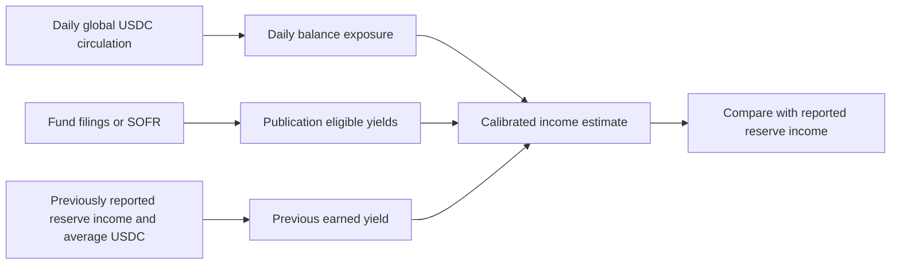

# Circle reserve income research

**Can publicly available USDC balances and interest-rate disclosures estimate Circle's quarterly reserve income before earnings?**

This project tests that question by combining on-chain balance data with financial-statement analysis. It starts with simple baselines, adds current public rates, calibrates the difference between a benchmark yield and Circle's previously reported economics, and checks every estimate against reported reserve income.

The completed report covers **reserve income**. It does not claim to forecast total revenue, net income, EPS or the CRCL share price. Earlier work on those extensions is retained separately so readers can inspect unsuccessful approaches as well as the stronger results.

## Start here

- [Interactive dashboard](https://ziyik0612.me/circle/)
- [Read the report online](https://ziyik0612.me/circle/report.html)
- [Download the latest PDF](../../circle/Circle_Reserve_Income_Report.pdf)
- [Download the editable Word report](../../circle/Circle_Reserve_Income_Report.docx)
- [Quarter-by-quarter backtest CSV](reserve_report/site/circle/data/backtest.csv)
- [Daily model inputs and filing accessions](reserve_report/site/circle/data/daily_inputs.csv)
- [Data dictionary and source map](DATA_DICTIONARY.md)
- [Test results and reproduction guide](TEST_RESULTS.md)
- [Snapshot file hashes](FILE_MANIFEST.json)

The report and this snapshot are dated **22 November 2026**. Data are archived observations, not a live feed. The website's automatic VM updates are not activated.

## What the historical test found

The accounting ledger contains seven quarters, Q1 2025 to Q3 2026. Q1 2025 provides the first lagged calibration; the following six quarters are the prediction targets. Each target is reconstructed at two cutoffs: seven calendar days after quarter-end and the day before the original earnings release.

At the later cutoff:

| Method | Mean absolute percentage error | Mean absolute dollar error | Worst absolute percentage error |
| --- | ---: | ---: | ---: |
| Prior income, adjusted for quarter length | 6.287% | $42.114m | 11.062% |
| Current supply, prior earned yield | 3.281% | $22.614m | 8.636% |
| Current supply, uncalibrated SOFR | 5.140% | $34.785m | 5.573% |
| SOFR with prior yield gap | 0.337% | $2.268m | 0.896% |
| Fund yield with prior yield gap | 0.237% | $1.579m | 0.587% |
| Fund yield with prior yield ratio | **0.156%** | **$1.025m** | **0.412%** |

The main finding is that daily supply becomes substantially more useful when an observable yield is calibrated to the previous quarter's company result.

**Interpretation matters:** these are six historical quarters, using later-downloaded supply and rate histories while filtering financial and fund disclosures by publication date. The ratio variants were compared later on the same sample. Their low errors are exploratory results, not an independent holdout or a guarantee of future accuracy. MAPE is an average percentage miss; it is not a probability that a forecast will be correct.

## How the model works



The dashboard's selected method is **fund yield with prior yield ratio**:

1. Infer the previous quarter's annual company yield: previous reserve income / reported average USDC × 365 / quarter days.
2. Calculate the previous quarter's USDC-supply-weighted fund yield from the eligible net seven-day yield observations.
3. Divide the company yield by the fund yield to obtain the prior yield ratio.
4. For the target quarter, sum each daily USDC balance × eligible annual fund yield × prior ratio / 365.

USDC balances are valued at dollar par. We use DefiLlama's global circulation series, rather than manually summing every token named USDC across chains. Bridge representations require careful accounting to avoid counting the same backing twice. The supply proxy is checked against Circle's quarterly average and quarter-end disclosures. A separate Ethereum mint/burn reconstruction provides a direct-chain validation sample; it is not an all-chain audit.

The SOFR comparison uses a prior **percentage-point yield gap**, with the 360-day SOFR convention reconciled to the company's 365-day implied yield. These are economically different specifications, and both remain inspectable in the report and code.

## What is in this repository

| Folder | Contents and role |
| --- | --- |
| `reserve_report/` | Latest Word, PDF and Markdown report; public dashboard datasets; web edition; report checks; signed-error chart and exact values. |
| `feasibility/` | Free-source feasibility tests, historical RPC checks, downloaded inputs and findings. |
| `stage2/` | SEC financial ledger, supply reconciliation, attestations, archived sources and controls. |
| `stage3/` | Reserve-income methods, original monthly fund filings, daily inputs, historical estimates and independent checks. |
| `monitor/` | Tested reusable forecast engine, dated public export, tests, audited seed and inactive deployment templates. |
| `downloaded_monitor_http/` | Original public HTTP bodies, cache indexes and retrieval receipts from the live collector test. No mutable production account state is included. |
| `data_inventory/` | Wider Circle-related on-chain source checklist and public endpoint access checks. |
| `stage4/` | Exploratory work on other revenue, ARC disclosures and transaction fees. These are not validated EPS forecasts. |
| `stage5/` | Ethereum USDC/CCTP extraction, regressions, distribution-cost/RLDC scenarios and exploratory results. |
| `sources/` | Additional original public filings downloaded during research. |
| `outputs/` | Author-generated analytical workbooks, except the workbook containing the licensed Workspace cross-check. |

Raw response files and large chain logs are retained, including existing gzip archives. Source manifests identify URLs, retrieval dates and hashes where recorded. The original stage notes are chronological research artifacts; the latest report defines the completed reserve-income study. A historical assumption in an exploratory stage is not automatically the current forecast policy.

## Reproduce the checks

Requirements: **Python 3.10+**, **Node.js** for the JavaScript checks, and **Git** for the local publisher integration tests. The recorded run used Python 3.12. No paid API key or AI service is required for the core offline reserve-income checks.

From this folder:

```sh
python -m venv .venv
# Activate .venv using your operating system's normal command.
python -m pip install -r requirements.txt

# Report arithmetic, historical coverage, hashes and local links.
python reserve_report/verify.py
node reserve_report/verify_model.mjs

# Date handling, original filing parsers, historical replay,
# immutable forecasts, earnings validation and local Git publication.
cd monitor
python verify.py
node verify_monitor.mjs
```

The checks write receipts inside the snapshot; run them in your own clone. Original-source downloads can be large. Use the committed receipts and CSVs for an initial review, then run the offline checks for independent verification.

The small `reserve_report/repository/circle/` subtree is only a compatibility fixture for the existing tests. It contains data and calculation modules, **not another Git repository**.

For live collection, follow [the monitor instructions](monitor/README.md). Set your own public contact in the example configuration. The system preserves dated forecasts and separates historical replay from prospective scoring. Current-quarter scenarios use explicit flat future supply/rate assumptions and remain unscored until a reported actual can be matched to a genuinely earlier saved forecast.

## Scope and limitations

- Reserve composition, bank deposit yields, other reserve assets and accounting timing are not fully observable from USDC token supply.
- Monthly fund yields must not be used before their filing publication date. A carried observation is different from a freshly published daily value.
- Historical API date buckets do not establish an exact end-of-day blockchain state. Supply reconciliation is a tolerance check, not proof of identical definitions or observation times.
- Strong reserve-income estimates do not automatically imply strong EPS estimates. Distribution costs, other revenue, operating costs, taxes and share count remain separate problems.
- The Ethereum/CCTP archives demonstrate direct event extraction. Fee collection on chain is not automatically the same as Circle's recognized consolidated transaction revenue.
- Synthetic 2027 dates in lifecycle tests are test fixtures, not future financial results.

## Publication boundaries

This public snapshot excludes credentials, account connection helpers, installed `node_modules`, Python caches, local Git history, mutable production state and duplicate editing backups. Raw licensed Refinitiv/LSEG exports and the workbook that reproduces the licensed cross-check are not redistributed. The core reserve-income reproduction uses the public SEC ledger instead. Details are recorded in [EXCLUSIONS.json](EXCLUSIONS.json).

Third-party filings, data and downloaded source code retain their original rights and attribution. Inclusion in this research archive does not apply a new blanket license to those materials. Live source availability, API limits and layouts can change after the snapshot date.

Author: **Zi Yik** · [Website](https://ziyik0612.me) · [Dashboard](https://ziyik0612.me/circle/)
