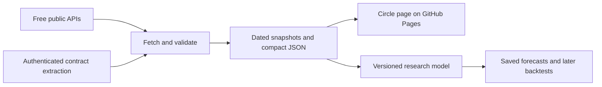

# Circle dashboard on ziyik0612.me

Prepared 22 November 2026. **Feasibility and integration plan; no website files, branches, workflows or deployments were changed.** The user's request was to investigate the website setup and assess a dashboard alongside the report.

## Verified existing setup

The `ziyik0612.me` chat identifies the repository as [TINZY0612/TINZY0612.github.io](https://github.com/TINZY0612/TINZY0612.github.io). The connected GitHub tool successfully read the repository, file tree, current commit, CNAME and deployment runs; the repository response reports push permission. No access key was retrieved, displayed or saved. Read access is verified; no write was attempted.

The default branch is `main`, the repository is public, GitHub reports Pages enabled, and `CNAME` contains `ziyik0612.me`. The checked head is `5f7d67538fe6415237999325fbbff4bf8c74d260`, dated 18 October 2026. The associated [Pages deployment](https://github.com/TINZY0612/TINZY0612.github.io/actions/runs/39178258175) completed successfully. The recursively listed tree is not truncated; it contains static HTML, `assets`, `news`, `resume` and `scripts`, with no checked-in `.github/workflows`, package manifest or AGENTS.md found in that tree. This is a current repository inspection, not a claim about future changes.

Navigation is generated by `scripts/sync-site-topbar.cjs`. It recursively updates index pages and currently links Resume, AI Projects and Paper Ledger. A new Circle link should be added through that existing generator after inspecting its full implementation and checking for concurrent repository changes. Existing links and the private ledger's authentication should be preserved.

## Recommended design

Add a native static page at **`/circle/`**. It can match the existing website and serve as the public companion to the research report. Use DefiLlama for daily public aggregates, our own contract extraction for auditable samples, and explicit references to primary financial data. Dune is an additional SQL source once account/API access is available, rather than a dependency for the first version.

GitHub Pages serves static HTML/CSS/JavaScript; it does not run a persistent data collector. Periodically download and validate source data in a separate job, publish compact JSON, and let the page read that JSON. GitHub's [Pages description](https://docs.github.com/en/pages/getting-started-with-github-pages/what-is-github-pages) supports this architecture. No API keys belong in page JavaScript or public JSON.



### Proposed page sections

| Section | First-version contents | Data / refresh |
| --- | --- | --- |
| USDC reserves | Circulation trend, quarter-to-date average, major-chain breakdown, net changes | DefiLlama daily data; native/bridged perimeter stated |
| Reserve-income monitor | Observed supply × estimated earned yield; actual vs historical estimate; separate projected remaining days | Existing versioned reserve method; off-chain rate inputs explicitly labeled |
| CCTP | Daily global/chain fees, route volume, fee-paying counts, concentration | Provider daily feed; direct Ethereum Q3 audit shown as a fixed verified sample |
| USYC | NAV, reported share supply, calculated fee component and recent report date | Latest public report API plus archived chain reports; no false full-history claim |
| EURC | EUR circulation, USD equivalent and separate contribution if modeled | Free registry/history access verified; matched FX/rates still needed |
| Arc | Mainnet-qualified adoption, DEX/bridge activity and authenticated gas metrics when available | Separate network/apps/Circle entitlement; pre-mainnet history quarantined |
| Research model | Reserve income → costs → RLDC, assumptions and actual comparisons | Versioned financial inputs; EPS only after the expense/tax/share bridge is completed |
| Data audit | Sources, as-of times, missing periods, validation badges, unresolved $5,256 CCTP gap | Local validation manifest and linked raw/source evidence |

Prioritize four headline cards: USDC circulation, quarter-to-date average USDC, observed quarter-to-date CCTP fees, and latest USYC fee observation. Estimates must say “estimate”; never put an estimated EPS card on the page before that model exists. Charts should offer a data table/download, clear units and definitions, and usable mobile layouts.

### Proposed files, not yet installed

```text
circle/index.html
assets/circle-dashboard.css
assets/circle-dashboard.js
data/circle/latest.json
data/circle/history-daily.json
data/circle/forecasts/YYYY-MM-DD.json
scripts/update-circle-data.py
.github/workflows/update-circle-data.yml
```

Keep large RPC logs and full provider responses in the research archive, not in the page's initial download. The tested USDC response alone was approximately **23.7 MB** uncompressed. Convert it to a compact, defined set of daily totals and material-chain series. Loading the full response on every browser visit would be wasteful and harder to audit.

## Refresh approach and costs

**Recommended first version: once daily, after the prior UTC day's data is available, with a manual refresh workflow.** A GitHub Actions job fetches free public sources, validates dates/units/schema, and creates a data-only update. Deploy through the repository's established Pages setup. No schedule was created by this investigation.

Use the workflow's repository-scoped `GITHUB_TOKEN`, with only the permissions needed for the chosen publishing method; a personal access token is not inherently required. If updates commit generated JSON, scope write access to that job and avoid a push-trigger loop. If switching to a Pages-artifact workflow, that deployment change needs its own tested integration because it changes how the existing site publishes. Branch protections and workflow permissions should be rechecked at implementation time; a repository `push` capability is not proof that every workflow write will be allowed.

GitHub Actions [scheduled workflows](https://docs.github.com/en/actions/reference/workflows-and-actions/events-that-trigger-workflows#schedule) are best-effort and can be delayed. A daily refresh is an updateable research dashboard, not a guaranteed real-time service. More frequent collection is possible, but provider publication frequency, quotas and cache behavior determine whether it adds information. A later serverless cache is an option if genuinely frequent contract-level updates become useful.

DefiLlama's tested APIs require no API key. Twelve public downloads succeeded in this audit; one Dune result request without a key returned 401. Dune query execution, result retrieval, scheduling and quotas should be checked against the user's actual plan before adding it. Never pay or activate a new service implicitly. Existing free sources can support the first version; continued availability, redistribution terms and fair-use limits still need to be respected.

**Alternative: embed Dune charts.** This can shorten initial UI work if an eligible public visualization supports embedding, but branding, cached results, query schedules, layout and API/plan limits remain controlled by Dune. Embedding support was not end-to-end tested here. A native dashboard with downloadable data and an explicit model is the stronger research portfolio artifact.

## Data contract and failure behavior

Each series should carry:

```json
{
  "metric": "cctp_fee_usdc",
  "unit": "USD_at_USDC_par",
  "scope": {"chain": "Ethereum", "version": "CCTP_V2", "asset": "native_USDC"},
  "period_start": "2026-07-01T00:00:00Z",
  "period_end_exclusive": "2026-10-01T00:00:00Z",
  "value": 154093.848015,
  "classification": "observed_protocol_fee_not_GAAP_revenue",
  "source": "archived_direct_contract_events",
  "coverage": "quarter_complete_for_stated_contract_scope",
  "validation": "decoded_and_token_checked_aggregator_difference_unresolved"
}
```

The production schema must also include retrieval time, source observation time, query/adapter/model version, raw-evidence hash, final block where applicable, expected/observed days, and `actual` / `observed` / `estimated` / `assumed` classification. Preserve source date semantics: a provider point labeled today may be partial and must not be presented as a completed day's average.

Use `null` plus a missing-data flag when observations are unavailable. If a provider fails, retain the last successful series and display its age and error status; never silently replace a missing fee day with zero. Publication should fail or quarantine affected metrics when the schema, chain/asset scope, duplicate-event or material reconciliation checks fail. Other independently valid metrics can still refresh with their own timestamps. No page should imply that all inputs refreshed together when only one did.

Every forecast is immutable once dated. A new refresh creates a new forecast version. Keep realized data and prior forecasts separate so future accuracy can be measured without overwriting the evidence. Today's revised provider history must not be passed off as the exact input available to an analyst months earlier.

## Concrete implementation sequence

1. Re-read the current repository head and instructions; create an isolated reviewable branch when building is authorized. Keep all research and staging work in the Circle workspace until integration.
2. Build a small collector from the verified free endpoints and the [inventory](Onchain_Data_Checklist.md). Normalize USD/EUR/share units and exclude incomplete current dates from completed-day statistics.
3. Add the static page and compact data, matching the existing site. Show the direct-chain audit as a historical sample, not a continuously refreshed all-chain measurement.
4. Verify responsive layout, table/download access, source links, stale/missing states and that no secrets are shipped. Check accounting labels and native/wrapped deduplication.
5. Review the page and data diff before publishing; then add the navigation link using the existing generator and validate the Pages deployment.
6. Add a daily refresh workflow only after validating its permissions, update behavior and rollback. Save dated model outputs independently from chart refreshes.

The dashboard adds value because readers can inspect the evidence behind the report and later compare a dated forecast to actual earnings. Its purpose is not to turn every observable blockchain transaction into Circle revenue.
